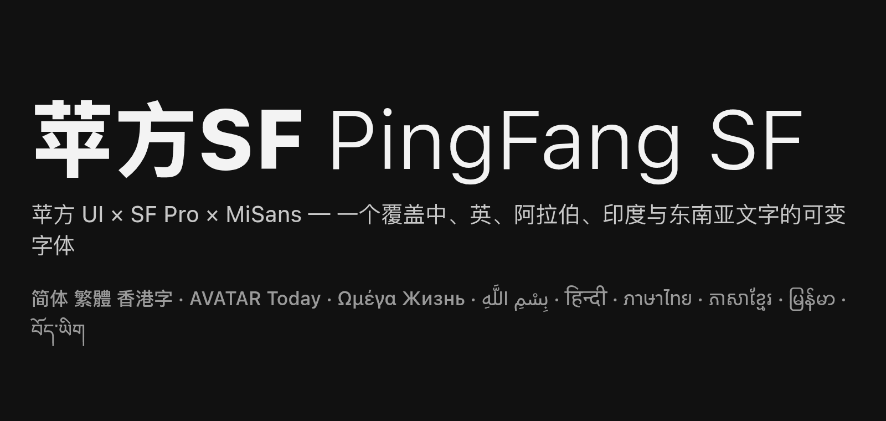
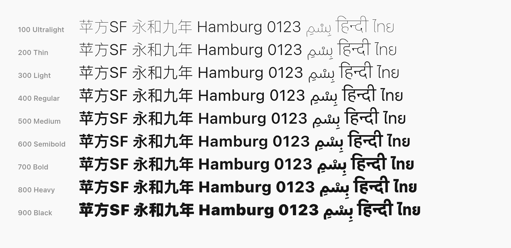
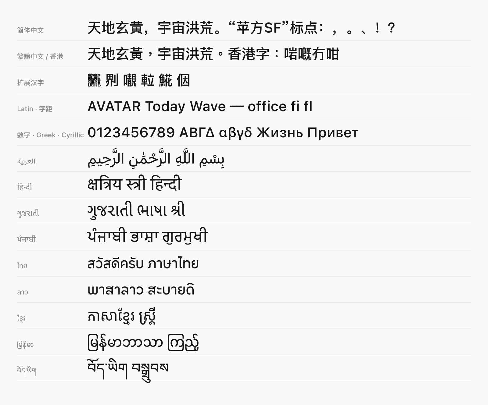
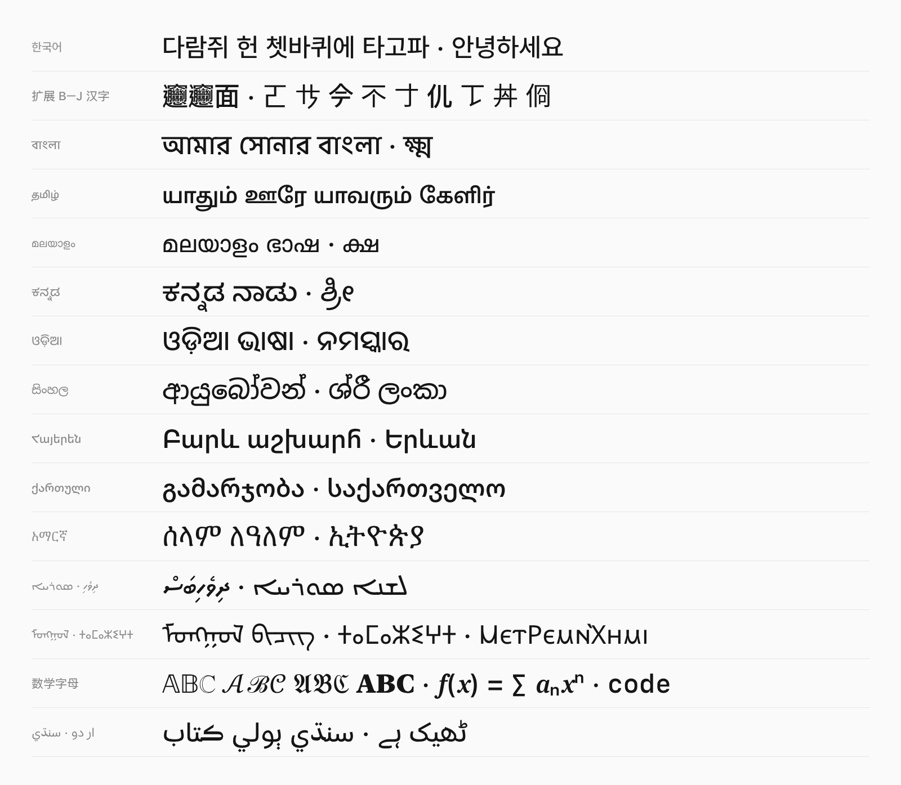
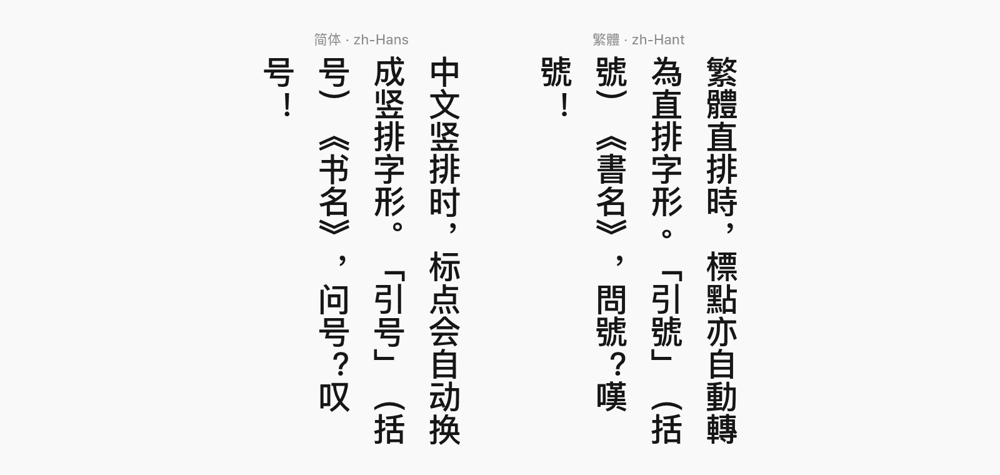

# 苹方SF · PingFang SF


https://github.com/user-attachments/assets/ffc8044a-b8ae-462b-90fd-bd57496cab01




以 **苹方 UI（PingFang UI）** 可变字体为底本，拉丁/希腊/西里尔文使用 **SF Pro**，并补充 **MiSans** 的 9 种文字、Source Han Sans 等来源汉字，以及 v1.2.0 按真实使用频率补入的韩文、扩展区汉字、多种印度与少数民族文字和数学字母的个人合并字体。一个文件、两个可变轴（字重 100–900、字宽 80–120），字形数达到 TrueType 上限 65,535。

> ⚠️ **仅供个人、非商业的学习研究使用。** 本仓库不提供任何开源许可，各组成字体版权归原权利人所有。详见文末 [许可与免责声明](#许可与免责声明) 和 [NOTICE.md](NOTICE.md)。

## 特性

**v1.2.0 一句话**：字形数用满 TrueType 上限 65,535，覆盖 56,497 个码位、37 种文字；新增韩文、扩展 B–J 汉字、孟加拉 / 泰米尔 / 马拉雅拉姆 / 卡纳达 / 奥里亚 / 僧伽罗 / 亚美尼亚 / 格鲁吉亚 / 埃塞俄比亚等文字和数学字母，按维基百科实测，中文页面中原先显示为方框的字符减少 99.96%。

- **可变字体**：`wght` 100–900（9 个命名实例 Ultralight → Black），`wdth` 80–120。
- **完整的 OpenType 排版**（v1.1 起，GSUB 440 个查找表 / GPOS 67 个 / GDEF）：
  - 中文：`vert` 竖排标点、`locl` 地区字形（zh-Hant / zh-HK / zh-MO / ja）、`fwid` / `hwid` / `pwid` / `nalt`；
  - 拉丁：**可变字距 `kern`**（随字重与字宽变化）、`ccmp`、`locl`、`case`、`frac`、`numr` / `dnom`、`sups` / `subs`、`tnum` / `pnum`、`smcp` / `c2sc`、`ordn`，以及 SF Pro 的 `ss01–ss14`、`cv01–cv13` 等；
  - 阿拉伯文：连写（`init` / `medi` / `fina` / `isol`）、`rlig` 连字（لا、الله 等）、`dlig`、元音符号 `mark` / `mkmk` 定位与 GDEF 标记类别；
  - 天城文、古吉拉特文、古尔穆基文、高棉文、老挝文、缅甸文、泰文、藏文：MiSans 的全部 GSUB / GPOS / GDEF（连字、半体、reph、上下标叠放、标记定位）。
- **9 种 MiSans 文字也可变字重**（v1.1 起，原为静态）。
- **思源黑体来源的假名、符号与补充汉字也可变字重**（v1.2.0 起，759 个码位，原为静态）。
- **v1.2.0 精简**：删除 8,329 个 SF Symbols 私用区字符（U+100000–1042F5，Windows 等平台无法正常使用，且受 SF Symbols 许可限制）；65 个默认以 emoji 呈现的字符（⌚☕⚽🆗🈯 等）不再映射，交给系统彩色 emoji 字体；新增 ⃀ U+20C0（吉尔吉斯索姆）与 ⃁ U+20C1（沙特里亚尔，取自 SF Pro），以及变体选择符、双向隔离符、标签字符、韩文填充符等 371 个默认可忽略字符的零宽字形（GDI 中不再显示方框）。
- **v1.2.0 补满 65,535 个字形**：按维基百科语料（中文 / 韩文 / 英文 / 粤语 / 文言）中缺字出现的页面频率排序，逐项补入 11,524 个码位：韩文 3,394（全部 2,350 个 KS X 1001 音节 + 语料中出现过的非 KS 音节与兼容字母，Pretendard，可变字重）、扩展 B–J 汉字 4,371（Plangothic）、孟加拉 / 泰米尔 / 马拉雅拉姆 / 卡纳达 / 奥里亚文（Apple SF India，可变，完整 GSUB/GPOS）、亚美尼亚（SF Armenian）、格鲁吉亚（SF Georgian）、埃塞俄比亚（Apple Kefa）、僧伽罗 / 塔安那 / 叙利亚 / 巽他 / 傈僳 / 新傣仂 / 缅甸文扩展（Noto，可变）、蒙古 / 提非纳 / 科普特 / 傣哪文（Noto）、740 个数学字母数字符号（New York / SF Pro / SF Mono / STIX Two）、148 个阿拉伯文新增字母（SF Arabic，3 个取自 Noto Sans Arabic）以及拉丁 / 西里尔扩展与符号。每个新增字形都对应一个在语料中出现过的字符，没有凑数。
- 中英文名均可识别：`PingFang SF` / `苹方SF` / `蘋方SF`，不与系统自带苹方冲突。

### 字重



### 多语种



### v1.2.0 新增文字



### 竖排



## 下载

当前版本 **v1.2.0**：[直接下载 `PingFang-SF-Medium.ttf`](https://github.com/Juwan-Hwang/PingFang-SF/releases/download/v1.2.0/PingFang-SF-Medium.ttf)（约 64 MB，与仓库中的 `PingFang-SF Medium.ttf` 相同），或到 [Releases](https://github.com/Juwan-Hwang/PingFang-SF/releases/latest) 查看说明与 SHA-256。

### 校验来源

每个 Release 的字体都由 GitHub Actions 生成来源认证（artifact attestation），版本标签由作者用硬件密钥签名。下载后可用 GitHub CLI 验证文件确实来自本仓库：

```bash
gh attestation verify PingFang-SF-Medium.ttf -R Juwan-Hwang/PingFang-SF
```

字体本身还带有 OpenType 数字签名（DSIG 表，Authenticode / PKCS#7，SHA-1 摘要 + DigiCert 时间戳），由作者的 YubiKey 硬件密钥签署。签名证书为自签证书，公钥见 [`signing/PingFang-SF-signing-cert.cer`](signing/PingFang-SF-signing-cert.cer)：

- 主体：`CN=Juwan Hwang, O=PingFang SF Project`
- SHA-1 指纹：`4959BD61D927497F28941DB3454E921FD3E9D969`
- SHA-256 指纹：`fa85f6c6d0d007696d64f2dd7a15060c5cfadc3d4632961b9fd6a1d755ffb73f`

Windows 上可用 `signtool verify /pa /v PingFang-SF-Medium.ttf` 查看签名；因证书为自签，会提示根证书不受信任，核对上面的指纹即可。DSIG 在 OpenType 1.9 中已被弃用，主要供旧版 Windows/Office 识别，来源认证请以上面的 attestation 为准。

## 安装

- **Windows**：右键 TTF →「为所有用户安装」。
- **macOS**：双击 TTF → 字体册「安装」。
- **Linux**：复制到 `~/.local/share/fonts/`（或 `~/.fonts/`），运行 `fc-cache -f`，然后用 `fc-list | grep "PingFang SF"` 确认。

## CSS 用法

已安装到系统时：

```css
body {
  font-family: "PingFang SF", "苹方SF", "PingFang SC", sans-serif;
  font-weight: 500;            /* 100–900 任意值 */
}
```

作为网页字体自托管时请先确认你有权这样做（本字体**不允许**再分发，见下文）；仅本地测试时可以：

```css
@font-face {
  font-family: "PingFang SF";
  src: url("PingFang-SF-Medium.ttf") format("truetype");
  font-weight: 100 900;
  font-stretch: 80% 120%;
}
.vertical { writing-mode: vertical-rl; }   /* 竖排时自动启用 vert */
```

## 可变轴

| 轴 | 范围 | 默认 | 命名实例 |
|---|---|---|---|
| `wght` 字重 | 100 – 900 | 500（Medium） | 100 Ultralight · 200 Thin · 300 Light · 400 Regular · 500 Medium · 600 Semibold · 700 Bold · 800 Heavy · 900 Black |
| `wdth` 字宽 | 80 – 120 | 100 | — |

各部分的可变情况：

| 部分 | 字重 | 字宽 | 说明 |
|---|:-:|:-:|---|
| 苹方汉字、假名、标点（含扩展 A 全部） | ✅ | ✅ | 苹方 UI 原生可变数据 |
| 拉丁 / 希腊 / 西里尔（SF Pro，约 1,740 个码位，含 ASCII） | ✅ | ✅ | v1.1 用 SF Pro 在 15 个母版位置重建（opsz=17），字距同步可变 |
| MiSans 9 种文字 | ✅ | — | MiSans 150–700 映射到 100–900（500 ↔ MiSans Medium 380），字宽轴不改变这些文字 |
| 思源黑体来源的假名、注音扩展、汉文训读符号、片假名扩展、带圈 / 方块 CJK 字、部分扩展 B–H 汉字及符号（759 个码位） | ✅ | — | v1.2.0 起改用思源黑体 2.005 可变字体，字重按苹方笔画粗细对应（见下） |
| TH-Hak 补充字及其余符号（约 5,200 个码位） | — | — | 静态，详见已知限制 |

思源黑体部分的字重对应（按苹方 UI 自身汉字 一 三 川 丨 工 目 二 的笔画粗细逐级拟合，`build/shs_select.py --stems`）：苹方 100 ↔ 思源 ExtraLight 再细约 6%（苹方 Ultralight 比思源最细还细，按思源两个母版的差值向外延伸）、400 ↔ 思源约 367、500 ↔ 约 476、700 ↔ 约 632、900 ↔ 约 886（接近 Heavy）。

## 字符覆盖

由 `build/coverage_stats.py` 统计（v1.2.0）：

| 分类 | 码位数 |
|---|--:|
| 基本拉丁 / 拉丁扩展 / IPA / 组合符号 | 1442 |
| 希腊文 | 368 |
| 西里尔文 | 433 |
| 阿拉伯文（含表现形式） | 581 |
| 天城文 | 128 |
| 古尔穆基文 | 78 |
| 古吉拉特文 | 85 |
| 泰文 | 87 |
| 老挝文 | 82 |
| 藏文 | 211 |
| 缅甸文 | 223 |
| 高棉文 | 142 |
| 韩文（音节 / 兼容字母 / 带圈与括号韩文） | 3477 |
| 孟加拉 / 泰米尔 / 马拉雅拉姆 / 卡纳达 / 奥里亚文 | 465 |
| 僧伽罗 / 塔安那 / 叙利亚文 | 218 |
| 亚美尼亚 / 格鲁吉亚 / 埃塞俄比亚文 | 683 |
| 蒙古 / 提非纳 / 科普特 / 傈僳 / 傣哪 / 新傣仂 / 巽他文 | 592 |
| 数学字母数字符号 | 740 |
| 标点 / 符号 / 箭头 / 数学 / 几何等 | 3184 |
| CJK 符号与标点 / 假名 / 注音 / 笔画等 | 1615 |
| CJK 统一汉字（基本区） | 20992 |
| CJK 扩展 A | 6592 |
| CJK 扩展 B | 11143 |
| CJK 扩展 C–I | 1750 |
| CJK 兼容汉字 | 537 |
| 私用区（BMP：Apple 标志 U+F8FF 及 GB 18030 / HKSCS 旧编码字符） | 118 |
| 其他 | 740 |
| **总计** | **56,497 码位 / 65,535 个字形** |

v1.2.0 起不再收录的韩文音节只出现在维基百科的“音节表”类页面里（韩文维基中页面频率 ≤ 1），占韩文音节出现次数的 0.003%。

## 合并来源

| 来源 | 用途 |
|---|---|
| **PingFang UI TC**（底本，可变 wght+wdth，`21.4d1e1`） | 繁体字形、可变框架、GSUB（vert / locl / 全半角） |
| **PingFang UI HK / SC** | 补充香港字 +1,008、简体字 +3,560；中文标点使用 SC 字形 |
| **SF Pro**（可变） | 拉丁（含 ASCII）、希腊、西里尔等；字距（kern）与拉丁特性 |
| **MiSans** Arabic / Devanagari / Gujarati / Gurmukhi / Khmer / Lao / Myanmar / Thai / Tibetan（可变） | 9 种文字的字形与全部排版规则 |
| **思源黑体 Source Han Sans 2.005 可变字体**（`Variable/TTF/SourceHanSans-VF.ttf`） | v1.2.0 起：759 个码位（假名、注音扩展、汉文训读、CJK 符号、带圈/方块 CJK 字、部分扩展 B–H 汉字），可变字重；写法沿用原有的日本（默认）字形，但繁体（ZHT）写法不同的 7 个（⁇ ⁈ ⁉ ㍿ 🈻 𣟱 𨓜）改用 ZHT 写法 |
| **天珩字库-黑体 TH-Hak 4.0.0** | 其余补充扩展区汉字与符号（静态） |
| **Pretendard 1.3.9**（可变）/ **Noto Sans KR**（可变） | v1.2.0：韩文音节与兼容字母 / 带圈带括号韩文 |
| **Plangothic**（遍黑体 P1 6.400 / P2 3.179） | v1.2.0：4,371 个扩展 B–J 汉字（静态） |
| **Apple SF India 21.1d1e1**（可变）| v1.2.0：孟加拉、卡纳达、马拉雅拉姆、奥里亚、泰米尔文（含 GSUB/GPOS） |
| **Apple SF Armenian / SF Georgian / SF Arabic / Kefa III**（可变） | v1.2.0：亚美尼亚、格鲁吉亚文、阿拉伯文新增字母、埃塞俄比亚文 |
| **New York / SF Pro / SF Mono**（可变）、**STIX Two Math**（静态） | v1.2.0：数学字母数字符号（衬线 / 无衬线 / 等宽 / 花体·哥特·双线） |
| **Noto** Sinhala / Thaana / Syriac / Sundanese / Lisu / New Tai Lue / Myanmar / Sans（可变）、Mongolian / Tifinagh / Coptic / Tai Le / Symbols 2 / Music（静态） | v1.2.0：对应文字与符号 |
| **Apple Symbols**、**Segoe UI Symbol** | v1.2.0：其余符号（静态） |

## 构建 / 复现

v1.0 的合并（苹方 UI + SF Pro + 各补字来源）是基底，保存在 git 历史的 `ad938e1` 提交中；v1.1 的修复全部由 `build/` 中的脚本完成，可完整复现：

```bash
pip install fonttools uharfbuzz numpy brotli freetype-py   # freetype-py 仅 build/shs_select.py 需要
sudo apt install p7zip-full opentype-sanitizer      # 7z 解包 DMG；ots-sanitize 校验
build/fetch_sources.sh        # 下载苹方 UI(VF)、SF Pro.dmg、MiSans 全家桶、思源黑体 VF 并解包到 sources/
build/build.sh                # 生成 "PingFang-SF Medium.ttf" 并运行全部校验
```

流程：

1. `step2_sf_vf.py`：选出基底中 SF 结构的拉丁/希腊/西里尔码位，从 SF Pro 子集化（含特性闭包），缩放 UPEM 2048→1000，在 15 个目标位置实例化（opsz=17；wght 映射拟合苹方 UI 内置拉丁：100→236 … 500→540 … 900→1000；wdth 不变），再用 `varLib` 重建为目标坐标系下的可变字体。
2. `step3_misans_vf.py`：同样方式把 9 个 MiSans 可变字体在 9 个字重位置实例化并重建（MiSans 150/200/250/330/380/520/630/680/700 ↔ 100…900）。
3. `step4_integrate.py`：
   - 用轮廓哈希把苹方 UI TC 的字形对应到基底字形，子集化苹方 GSUB（vert/locl/fwid/hwid/pwid/nalt）并补入缺失的 822 个竖排/地区字形（含 gvar）；
   - 用重建结果替换 SF（1,687 个）/ MiSans（1,578 个）字形的轮廓与 gvar，并补入 SF 的 1,436 个、MiSans 的 3,399 个替代/连字/组件字形；
   - `layout_merge.py` 把各来源的 GSUB / GPOS / GDEF（含 GDEF ItemVariationStore、MarkAttachClass、MarkGlyphSets、高棉文 FeatureVariations）合并为一套，`layout_sort.py` 按目标字形 ID 重排所有 Coverage 及并行数组；
   - 修正 8,049 个纵向前进宽度为 0 的字形（vmtx）、把 7 个带三次曲线标志的字形转为二次曲线、由 gvar 重建 HVAR。
4. `step5_finalize.py`：中英文名称；`name` 表 ID 0/7/8/9/10/11/12/13/14 的版权、商标、制作者、说明与许可（英文 + zh-CN + zh-TW）；命名实例的 PostScript 名；head.yMin/yMax（保持苹方原值 −232/902）。
5. `step6_notdef_metrics.py`（v1.1.1）：从苹方 UI TC 复制其 `.notdef`（方框内一个圆环，含 gvar，笔画随字重变化、宽度随字宽 800/1000/1200 变化，HVAR/vmtx 同步）；取消 13 个空白爪哇文占位码位；TH-Hak 中 36 个按 255/256 宽度绘制的扩展 B 汉字前进宽度 996→1000；16,907 个纵向前进为 500 的导入字形改为 1000（原点 860，与苹方一致）；按实际轮廓重算 head.xMin/xMax、hhea、vhea、maxp 与 OS/2.xAvgCharWidth（行高相关的 ascender/descender/lineGap/winAscent/winDescent 不变）。
6. `step7_shs_vf.py`（v1.2.0）：`build/data/shs_vf_glyphs.tsv` 列出的 759 个字形原位替换为思源黑体 2.005 可变字体（Adobe，glyf 格式，UPEM 1000）中同一字符、同一地区写法的字形——字形 ID、cmap、GSUB/GPOS 引用不变，字形总数不增加。思源黑体只有 ExtraLight / Heavy 两个母版（轮廓 = EL + t·(Heavy−EL)），按笔画粗细拟合得出 t 在本字体归一化坐标上两段线性：wght 100 → t = −0.063、500 → 0.519、900 → 0.985，因此每个字形只需与苹方相同的两组 gvar 数据（wght −1 与 +1），字宽轴不影响这些字形。前进宽度不变，但 5 个思源比例宽度的字形（⁇ ⁈ ⁉ 🄯 🅬）的宽度随字重变化，写入 HVAR；lsb = xMin，vmtx 按 VORG − yMax 重算。清单由 `build/shs_select.py` 生成：对每个静态且思源黑体也有的码位，在 wght 250–900 下栅格化思源的各地区写法（JAN 默认及 ZHS/ZHT/ZHH/KOR `locl`）与现有字形比较，IoU ≥ 0.9、外框偏差 ≤ 8 单位、面积误差 < 5%、且思源字形本身可变者入选（现有字形实为 TH-Hak 收录的思源黑体约 Regular 字重，按 256 单位网格重新量化过）。
7. `step8_cleanup.py`（v1.2.0）：
   - 取消 SF Symbols 私用区 U+100000–1042F5 的 8,329 个映射，只能经由它们到达的字形（含 GSUB 替代字形与仅作组件的字形）随后被清除；U+F8FF 及其余 BMP 私用区不变；
   - 取消 `data/emoji_presentation_unmap.txt` 中 65 个 Emoji_Presentation=Yes 字符的映射（Unicode 17 `emoji-data.txt`），仍被其他字符引用的字形保留（例如苹方 `nalt` 中 可→🉑 等 5 个）；
   - 合并完全相同的字形：轮廓、全部轴的 gvar、前进宽度/lsb、vmtx/VORG、HVAR、GDEF 类别与标记集均相同，且在每个 GSUB/GPOS 查找表中可互换（覆盖表、类定义、替换输入、连字组件位置、上下文规则位置、字距对/类、锚点均一致）才合并，否则跳过；cmap、组件引用与 GSUB 输出改指向保留字形；
   - 新增 U+20C1（SF Pro `riyalsaudisign`）与 U+20C0（SF Pro 西里尔 С + 按该母版 SF Pro 下划线粗细与位置绘制的横线，按国家银行“大写 С 加下划线”的定义构造），两者与 step2 同样在 15 个母版位置生成，随字重与字宽变化；新增零宽空字形 `ignorable.zw` 映射 371 个尚未映射的默认可忽略字符（FE00–FE0F、E0100–E01EF、180B–180F、2061–2064、2066–2069、061C、E0001、E0020–E007F、115F/1160/3164/FFA0）；
   - 由 gvar 重建 HVAR，再用 fontTools subsetter（全部脚本与特性、GSUB 闭包、组件闭包）清除所有无法到达的字形，包括 v1.0 遗留、无任何查找表引用的约 1,270 个阿拉伯文字形；
   - 统计写入 `build_work/step8_report.json`。
8. `step9_fill.py`（v1.2.0）：`gen_fill_specs.py` 把按频率排名的补字计划 `data/fillplan.json` 拆成每个源字体一个“部件”（`data/fill_sources.json`；`data/fill_trim.json` 记录为恰好凑满 65,535 而去掉的最低排名逐字项）。`fill_parts.py` 把每个部件子集化（含 GSUB 闭包），缩放到 UPEM 1000，可变来源在 wght 100/500/900 对应的源字重实例化后在目标归一化坐标上重建为可变字体（Apple SF 系列沿用 SF Pro 的字重对应，opsz 17；CFF2 的 SF India 三个母版联合转换为兼容的二次曲线），静态来源保持静态。`step9_fill.py` 把部件追加为新字形（轮廓、gvar、前进宽度、lsb = xMin、vmtx = 1000 / VORG − yMax），只为尚未映射的码位加 cmap，有排版规则的文字把部件的 GSUB/GPOS/GDEF 挂在该文字自己的脚本标签下；字体原有排版表作为第一个来源原样保留（含 FeatureVariations）。为使 (3,1) 格式 4 cmap 不超过 64 KB（原已 64,982 字节），按“首个映射码位”的顺序重新编号字形（字形名与所有表的内容不变），格式 4 降到约 24 KB。最后由 gvar 重建 HVAR、重算全局度量（head.yMin/yMax 仍固定为 −232/902）。
9. 校验：`ots-sanitize`、`validate_font.py`（fontTools 完整读写往返、gvar glyphCount、wght=100/900 静态实例化）、`validate_shaping.py`（HarfBuzz 与各源字体逐字形比对，见下）；`compare_shaping.py OLD NEW` 可对新旧两版逐字形比较轮廓、前进宽度与偏移（不依赖字形 ID）。

`validate_fill.py`（v1.2.0）检查字形数恰为 65,535、U+F8FF 与 118 个 BMP 私用区映射保留、计划内码位全部映射到非空字形，并用 HarfBuzz 在 wght 100/500/900 下逐簇比对 30 个新增部件的样例在合并字体与部件字体中的轮廓、前进宽度与偏移。

另外 `extract_apple_fonts.sh` 可从任意 Apple 字体 DMG 中提取 TTF/OTF；`merge_arabic_gsub.py` 是独立的小工具，把阿拉伯文排版规则**合并**（而非替换）进其他字体。

### 校验结果（v1.2.0）

- `ots-sanitize`（OTS 9.2.0）：通过；Chromium（Playwright headless shell）可加载并渲染。
- fontTools 读写往返、`maxp.numGlyphs` = gvar `glyphCount` = hmtx = vmtx = **65,535**：通过。
- `validate_fill.py`：146 项 0 失败——字形数恰为 65,535；U+F8FF 与 118 个 BMP 私用区映射保留，SF Symbols 私用区不存在；计划内全部码位均映射到非空字形；30 个新增部件的样例（韩文、扩展区汉字、5 种印度文字、僧伽罗、蒙古、叙利亚、塔安那、亚美尼亚、格鲁吉亚、埃塞俄比亚、数学字母等）在 wght 100/500/900 下，合并字体与部件字体的 HarfBuzz 排版结果逐簇一致（轮廓允许 lsb 取整造成的整体 ≤ 1 单位水平偏移）。报告见 [docs/validation/fill_report.txt](docs/validation/fill_report.txt)。
- `validate_shaping.py`：原有 9 种 MiSans 文字、拉丁字距、竖排等 0 失败。
- `compare_shaping.py`（补字前 → 补字后）：318 组样例中 288 组完全一致；30 组不同全部是原先显示 `.notdef` 的字符现在有了字形（𠀀 U+20000、𠀁 U+20001、科普特文 Ⲥ U+2CA4），没有回退。
- 渲染：[HarfBuzz wght 100](docs/validation/fill_w100.png) / [500](docs/validation/fill_w500.png) / [900](docs/validation/fill_w900.png)、[wdth 80](docs/validation/fill_w500_wd80.png) / [120](docs/validation/fill_w500_wd120.png)、[Chromium 混排](docs/validation/chromium_full.png)。

### 校验结果（精简与思源黑体部分）

- `ots-sanitize`：通过（v1.0 因三次曲线标志无法通过）。
- fontTools 读写往返、gvar `glyphCount` = `maxp.numGlyphs` = 50,102、wght 100/900 实例化：通过。
- 新旧对比（精简前后，`compare_shaping.py`）：阿拉伯文、拉丁/希腊/西里尔（含所有被合并的同形字与字距）、中日文（含 zh-Hant/ja `locl` 与竖排）及其余 8 种文字共 318 组样例，在 wght 100/400/700/900 与 wdth 80/120 下排版结果（轮廓、前进宽度、偏移）完全一致。
- HarfBuzz 对比（157 项，0 失败）：9 种文字的样例在 wght 100 / 500 / 900 下与对应 MiSans 源字体的字形、前进宽度、标记偏移一致（偏差 ≤ 1 单位）；`AV` `To` `Ty` `LT` 字距分别为 −63 / −96 / −48 / −92；竖排 `，。、「」（）《》：！？` 与苹方 UI SC 的竖排字形一致。完整报告见 [docs/validation/shaping_report.txt](docs/validation/shaping_report.txt)。
- 思源黑体部分：抽样 65 个替换字形在 wght 400 / 500 / 700 / 900 下与思源黑体对应字重（约 367 / 476 / 632 / 886）的实例外框偏差 ≤ 2 单位，5 个比例宽度字形的前进宽度一致，其余替换字形的前进宽度与 v1.1.1 相同；wdth 80 与 120 下这些字形完全相同。
- 缺字显示：HarfBuzz（`hb-view`，无回退）下 U+D55C 한、U+20000 𠀀、U+A989 ꦉ 均显示 `.notdef` 方框，wght 100/500/900 下笔画粗细随之变化；Chromium 中 U+20000 显示方框。
- 重新运行 `build/build.sh` 得到的字体与仓库中的 `PingFang-SF Medium.ttf` 逐表一致（`head` 时间戳与校验和除外；发布文件另含数字签名 `DSIG`）。

## 已知限制

- **授权**：组成字体均非开源（SF Pro 许可明确禁止再分发），本仓库只是个人研究用途的合并实验，存在版权风险。
- **静态部分**：约 5,200 个码位（v1.1.1 为约 5,950 个）没有可变数据，在任何字重下都保持原样：主要是 TH-Hak 补充的扩展 B 以后汉字（思源黑体没有这些字，无可变来源）、盲文 / 数学 / 技术符号、希腊扩展、IPA 扩展、爪哇文等；另有约 630 个思源黑体也有的码位保持静态，其中约 517 个是 TH-Hak 自己的写法（如括号/带圈数字与字母、半角片假名、部分数学符号），换成思源会改变字形，约 110 个在思源黑体中本身就不随字重变化（制表符、方块、部分技术符号与图形符号）。
- **思源黑体部分**：默认字重（500）下这 759 个字比 v1.1.1 略粗（v1.1.1 实际是思源约 Regular，现与苹方 Medium 的笔画粗细一致）；wght 100 由思源母版差值向外延伸约 6% 得到，因为思源最细的 ExtraLight 仍比苹方 Ultralight 粗。
- **MiSans 文字**只随字重变化，不随字宽变化；MiSans 最粗只有 700（Heavy），所以 800–900 与 700 差别很小；MiSans 最细 150 对应 100。
- **拉丁字重对应**沿用苹方 UI 内置拉丁的关系（wght 100 ↔ SF Pro 236，500 ↔ 540，900 ↔ 1000），因此 Ultralight 的拉丁比 SF Pro 自己的 Ultralight 粗；拉丁使用 SF Pro 的 Text 光学尺寸（opsz 17），字距也取自该尺寸。默认字重下 ASCII 与 v1.0 的差异 ≤ 1 个单位（实例化取整）。
- **底本是繁体（TC）**：简体中文（zh-Hans）文本里同一码位的地区字形仍是繁体/台湾写法（苹方 UI 的 `locl` 只提供 ZHT/ZHH/JAN/ZHTM，没有 ZHS 分支）；标点使用 SC 字形，zh-Hant 下自动换成居中的 TC 标点。
- **竖排**：`… — ～ ー` 等在源字体中也没有竖排字形，依赖排版引擎旋转；中文没有 `vpal` / `palt` 标点挤压（源字体也没有 GPOS）。
- **字形槽位已用满（65,535）**：再补字只能先删字。CJK 扩展 B 及以后仍只覆盖语料中出现过的字（v1.2.0 起 U+20000 𠀀 已收录）；泰卢固文（排名第一的未收录项，需 873 个字形）、爪哇文、N’Ko、加拿大原住民音节、切罗基文、彝文、女书等未收录；韩文只收常用与语料中出现的音节（3,394 个），古韩文字母未收录。
- **v1.2.0 新增部分**：扩展区汉字（Plangothic）、蒙古文、提非纳文、科普特文、傣哪文、符号与 STIX 数学字母是静态的，不随字重变化；傈僳、新傣仂、巽他文的源字体只有 400–700，埃塞俄比亚文 300–800，超出部分保持端点字重；新增文字都不随字宽变化。新增阿拉伯字母与缅甸文扩展字母来自不同来源，它们与原 MiSans 字形之间没有标记定位（单独使用正常）。缺字自 v1.1.1 起显示为 `.notdef` 方框（或由系统回退字体显示），不再是空白。
- **最宽字形**为三倍长破折号 ⸻ U+2E3B（2,668 单位，正常的宽字形）；v1.1.1 时的 2,872 单位 SF Symbols 私用区符号 U+102F90 已随 SF Symbols 一并删除。
- 文件较大（约 64 MB），不适合直接作为网页字体。

## 更新日志

### v1.2.0（2026-10-18）

- **补满 65,535 个字形**（TrueType 上限，字形 ID 0–65,534）：字形 62,782 → 65,535（精简后为 50,102，再补字），码位 52,994 → 56,497（精简后为 44,973，补字 +11,524）。补字顺序按维基百科语料中缺字的页面频率（中文 71%、英文 20%、韩文 4%、粤语 4%、文言 1% 加权）排名，排版复杂的文字整体收录，其余逐字收录；计划依据见 `build/data/fillplan.json`。
- 新增：韩文 3,394 个码位、扩展 B–J 汉字 4,371、孟加拉 / 泰米尔 / 马拉雅拉姆 / 卡纳达 / 奥里亚文、僧伽罗文、亚美尼亚文、格鲁吉亚文、埃塞俄比亚文、蒙古文、叙利亚文、塔安那文、提非纳文、科普特文、傈僳文、傣哪文、新傣仂文、巽他文、缅甸文扩展、数学字母数字符号 740、阿拉伯文新增字母 148、拉丁扩展-D/E、西里尔扩展、声调字母、麻将 / 扑克 / 多米诺 / 炼金术 / 音乐 / 箭头 / 几何扩展等符号。
- 为凑满 65,535，测得的阿拉伯字母 GSUB 闭包比计划多约 150 个字形，因此去掉计划末尾最低排名的 18 个扩展区汉字、32 个韩文音节、1 个阿拉伯字母与 3 个符号；泰卢固文未能收录。
- 字形重新编号（按码位顺序），使 Windows 用的格式 4 cmap 保持在 64 KB 以内；排版结果不受影响（`compare_shaping.py` 318 组样例中只有原先缺字、现已补上的字符不同）。
- 构建流程新增 `gen_fill_specs.py`、`fill_parts.py`、`step9_fill.py`、`validate_fill.py`、`render_fill.py` 与 `data/fillplan.json`、`fill_sources.json`、`fill_trim.json`、`fill_sources.sha256`。字体版本号 1.200。

- **思源黑体来源的字形可变化**：v1.0 从 TH-Hak 导入、实为思源黑体的 759 个静态字形（平假名 / 片假名 188 个、方块与带圈 CJK 字 258 个、注音扩展与汉文训读、片假名扩展、部分扩展 B–H 汉字 92 个、符号等）原位替换为 Adobe 思源黑体 2.005 可变字体中的同一字形（日本默认写法不变），随字重 100–900 变化，粗细按苹方笔画拟合；字形总数仍为 62,782。静态码位由约 5,960 个减到约 5,200 个。
- 构建流程新增 `step7_shs_vf.py`、`shs_select.py` 与 `data/shs_vf_glyphs.tsv`；`fetch_sources.sh` 下载思源黑体 VF（tag `2.005R`）。
- **繁体写法**：上述字形中繁体（ZHT）写法与日本写法不同的 7 个（⁇ ⁈ ⁉ ㍿ 🈻 𣟱 𨓜）改用思源黑体 ZHT 写法（与 ZHH 相同），字重对应不变；`shs_select.py` 相应规则为“有不同的 ZHT 写法时优先 ZHT”。
- **删除 SF Symbols**：U+100000–1042F5 的 8,329 个私用区字符及只经由它们到达的字形共 10,717 个字形删除（U+F8FF Apple 标志及 GB 18030 / HKSCS 旧编码的 BMP 私用区字符保留）。
- **emoji**：65 个 Unicode 默认以 emoji 呈现的字符（⌚⌛⏩–⏳◽◾☔☕♈–♓♿⚓⚡⚪⚫⚽⚾⛄⛅⛎⛔⛪⛲⛳⛵⛺⛽🆎🆑–🆚🈁🈚🈯🈲–🈺🉐🉑）不再映射，由系统彩色 emoji 字体显示；60 个字形删除，5 个仍被苹方 `nalt`（可→🉑 等）引用的保留。
- **合并重复字形**：34 组完全相同的字形中 15 组在所有排版查找表中可互换，已合并（如 說/說 兼容汉字、Ɔ/Ͻ、⮕/➡、↵/↲）；其余 20 组因字距类、`smcp`/`case` 替换或阿拉伯文连写规则不同而保留（如 H/Η、O/Ο、ە/ﻩ）。审计时的“207 组”中有 170 组属于 SF Symbols，已随其删除。
- **补字**：⃀ U+20C0（吉尔吉斯索姆）、⃁ U+20C1（沙特里亚尔，SF Pro 原字形），均随字重/字宽可变；默认可忽略字符（变体选择符、双向隔离符、标签字符、蒙古文自由变体选择符、韩文填充符等 371 个）映射到共用的零宽空字形。
- **清除孤立字形**：1,891 个从 cmap、GSUB 与组件均无法到达的字形删除。其中约 1,270 个是 v1.0 遗留的阿拉伯文字形：已核对 MiSans Arabic 源字体的 GSUB（18 个查找表），除只作用于拉丁数字间 `.` `:` 的 `calt`（及其 2 个子查找表）和源字体本身未引用的 1 个外全部已挂在 `arab` 特性上，这些遗留字形不是任何查找表的目标，因此删除而非恢复规则。
- 构建流程新增 `step8_cleanup.py`、`data/emoji_presentation_unmap.txt` 与 `compare_shaping.py`。
- 构建修复：`step6` 中 `maxp.recalc()` 会把 head.yMin/yMax 改写为轮廓极值 −1029/1432，导致 `build.sh` 的产物与发布文件（−232/902）不一致；现在在其后再固定为 −232/902。

### v1.1.1（2026-10-16）

- **缺字方框**：`.notdef` 原为空字形，缺字时显示为空白；现改用苹方 UI 自身的 `.notdef`（方框 + 圆环），随字重/字宽可变。
- **度量核查**：确认最宽前进宽度 2,872 来自 SF Pro 私用区符号 U+102F90（缩放正确，保留）；顺带修正与源字体不一致之处：13 个爪哇文码位映射到空白占位字形（已取消映射）、36 个 TH-Hak 扩展 B 汉字宽 996（改为 1000）、16,907 个导入字形纵向前进为 500（改为 1000，竖排不再重叠）；重算 head/hhea/vhea/OS/2 的全局度量，行高不变。
- **版权与许可信息**：重写 `name` 表 ID 0/7/8/9/10/11/12/13/14（英文 + 简体 + 繁体），逐项写明苹方 UI、SF Pro、MiSans、思源黑体、天珩字库-黑体 TH-Hak 4.0.0 等组成部分的权利人与许可；README 与 NOTICE 同步更新。字体版本号 1.110。

### v1.1.0（2026-10-16）

- 恢复 OpenType 排版：苹方 CJK 的 `vert` / `locl` / 全半角特性；SF Pro 的可变字距与拉丁特性；9 种 MiSans 文字完整的 GSUB + GPOS + GDEF（阿拉伯文元音、印度文字连字与叠放、东南亚文字标记定位）。v1.0 只有阿拉伯文的 5 个 GSUB 特性，没有 GPOS / GDEF。
- 9 种 MiSans 文字改为可变字重；默认字重从 MiSans Regular(330) 改为与苹方 Medium 匹配的 MiSans Medium(380)。
- 拉丁 / 希腊 / 西里尔统一由 SF Pro 在正确字重下重建（v1.0 中拉丁扩展、希腊、西里尔实际是 SF Pro 400，与 ASCII 的 540 不一致）。
- 修复 HVAR：v1.0 中后加入的字形被映射到汉字的宽度变化数据，在 wdth=80/120 时前进宽度错误（例如 Ж 变窄 200 单位）。
- 修复 8,049 个字形的纵向前进宽度为 0、`yen` 的 gvar 数据损坏、7 个字形带有三次曲线标志（导致 OTS / 浏览器拒绝）。
- 新增中文名称：`苹方SF`（zh-CN）、`蘋方SF`（zh-TW / zh-HK）；命名实例 PostScript 名改为 `PingFangSF-*`；补充版权、商标与许可说明。
- `merge_arabic_gsub.py`：修复 `arab_mappings` NameError、gvar 补丁重复执行、复制组件缺少 gvar / vmtx 时 KeyError、返回值恒为 0、验证只打印不判定等问题；改为合并进现有 GSUB 并处理 GDEF 与 LookupFlag。
- 新增可复现构建脚本 `build/`、`extract_apple_fonts.sh` 和校验脚本。

### v1.0.0

- 初始合并版本。

## 许可与免责声明

**本字体仅供个人、非商业的学习研究使用。** 本仓库不持有任何组成字体的版权，也不授予任何许可：

- PingFang（苹方）与 SF Pro 为 Apple Inc. 的财产与商标；MiSans 为小米公司的财产与商标；Source Han Sans 为 Adobe 依 SIL OFL 1.1 发布；天珩字库-黑体（TH-Hak）由沈天珩整理，作者声明其为非盈利学习研究用字库、不得收费或商用（[来源](http://cheonhyeong.com/Simplified/download.html)）。
- 本字体按“原样”提供，**不附带任何担保**；使用者须自行遵守各组成字体的许可协议，并自行承担使用后果。请勿商用、再分发或嵌入到产品中。
- 本项目与上述任何公司无关，也未获得其认可。
- **如权利人要求，将立即删除。** 请通过 [GitHub Issues](https://github.com/Juwan-Hwang/PingFang-SF/issues) 联系。

### 来源与版权

| 组成部分 | 版权声明（摘自源字体） | 许可 | 来源 |
|---|---|---|---|
| 苹方 UI 21.4d1e1 | © 2024-2025 Apple Inc. | Apple 专有字体 | [ACT-02/PingFangUI-VF](https://github.com/ACT-02/PingFangUI-VF)（第三方重建） |
| SF Pro 22.0d5e4 | © 2015-2026 Apple Inc. | Apple San Francisco 字体许可协议（禁止再分发/嵌入） | [Apple Developer Fonts](https://developer.apple.com/fonts/) |
| MiSans（9 种文字）1.000/1.100 | © 2020-2023 Beijing Xiaomi Mobile Software Co., Ltd. | 《MiSans 字体知识产权许可协议》 | [hyperos.mi.com/font](https://hyperos.mi.com/font) |
| 思源黑体 Source Han Sans | © 2014-2021 Adobe, Reserved Font Name “Source” | SIL OFL 1.1 | [adobe-fonts/source-han-sans](https://github.com/adobe-fonts/source-han-sans) |
| 天珩字库-黑体 TH-Hak 4.0.0 | Copyright TH-fonts（沈天珩整理；字形版权据作者说明属中易、华康、Iwata、Besta、方正） | 作者声明：非盈利学习研究用，不得收费、不得商用 | [cheonhyeong.com](http://cheonhyeong.com/Simplified/download.html) |

完整的来源与版权声明见 [NOTICE.md](NOTICE.md)。
